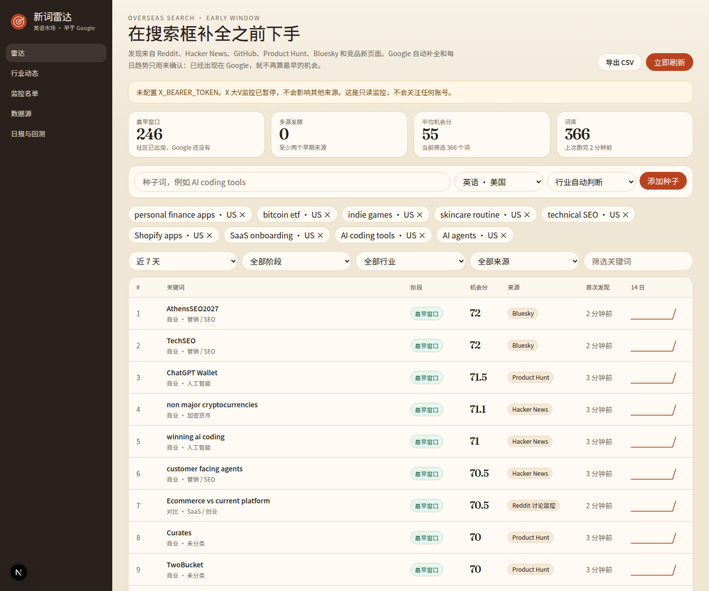

# SEO 新词雷达

给做英语市场的 SEO 用的早期关键词雷达。它不去等 Google 趋势变热，而是先听社区、新品、仓库、通讯和竞品新页面，再用 Google 自动补全和每日趋势确认这个词是不是已经晚了。

界面是简体中文。数据源只覆盖海外英语市场（美国为主，种子可以选英国、加拿大、澳大利亚）。没有中文平台。



## 本地运行

需要 Node.js 22。

```bash
npm install
npm run dev
```

打开 [http://127.0.0.1:4317](http://127.0.0.1:4317)。

第一次启动会在一两分钟内自己跑一轮采集。页面上的「立即刷新」可以手动再跑。默认每 4 小时再跑一次（`CRON_HOURS`）。数据在 `data/radar.db`，SQLite，不需要单独装数据库。

生产模式：

```bash
npm run build
npm start
```

请用长期运行的 Node 进程，不要丢到会冻结后台任务的 serverless 上。调度和手动刷新都活在这个进程里。

## 词是怎么来的

发现源（越早越好）：

- Hacker News（Algolia）
- Product Hunt 新品 RSS，有 `PRODUCTHUNT_TOKEN` 时改走官方 GraphQL
- GitHub Trending，外加近 7 天高星新仓库
- Reddit 讨论监控：按行业盯 subreddit。有 `REDDIT_CLIENT_ID` / `REDDIT_CLIENT_SECRET` 用官方 API，否则用公开 RSS，并限速
- Bluesky 公开搜索
- Stack Exchange 新问题
- YouTube 频道 RSS；有 `YOUTUBE_API_KEY` 时再补搜索、标签
- Substack / 通讯 RSS、Medium 标签 RSS
- Google News RSS：这是新闻信号，不是趋势验证
- Sitemap 监控：读 robots.txt 和常见 sitemap，只把带 `lastmod`、近 72 小时的新 URL 当新页面。抓正文前先看 robots.txt
- X 大V：只读时间线。没有 `X_BEARER_TOKEN` 就关闭，并在界面上说明，不会把进程打崩，也不会关注任何账号
- TikTok、Quora、Amazon Movers、Etsy：尽力而为，被拦就记一笔失败
- Discord、Telegram、Threads：只有对应 token 才启用

Google 不是发现源。每轮结束时，对分数最高的一批词做两件事：

- 用少一个字符的前缀问自动补全，看完整词是否已经会被补出来
- 对照美国每日趋势 RSS

已经出现在 Google 的词阶段变成「已被 Google 收录」，机会分会被压低。还只出现在早期来源里的，标成「最早窗口」或「多源发酵」。

## 分数

机会分把这些东西合在一起，详情页能看到拆解：

- 发现分：新近程度、快照间的动量、跨来源数、是否还没进 Google
- 多个 X 账号说到同一个词、Reddit 和 X 同时出现、多个竞品站同一轮写到，都会加分
- 竞争：有 `SERPAPI_KEY` 或 DataForSEO 就拉前 10；否则用 DuckDuckGo 公开结果粗分权威站 / UGC / 小站，弱结果标成蓝海
- 占位：用 RDAP 查精确匹配 `.com` 是否还能注册、是不是刚被注走
- 商业价值：工具、对比、价格、联盟这一类说法
- 生命周期：快照太少就标「观察中」；冲高回落标短期热点，持续出现标可持续
- 大纲：有 `OPENAI_API_KEY`（或兼容接口）就让模型写；否则用模板

回测只统计「第一次发现时 Google 还没有，后来才出现」的词，算平均领先小时。样本够了之后，会小步调整「早发现」权重，一天最多一次。

## 监控名单

行业：人工智能、SaaS / 创业、加密、电商 / DTC、营销 / SEO、健康、游戏、金融。

- X 大V、Reddit 社区、Reddit 活跃用户、竞品网站都可以改
- 采集时如果多个账号互相提及，或帖子里出现别的 `r/`，会变成「建议加入」。你点采用才会进下一轮
- 竞品新页面在「行业动态」里，词详情里也能看到 sitemap 证据

## 日报

默认每天 8:00（`Asia/Shanghai`）取还没被 Google 接住的前 10 个机会。

- 页面「日报与回测」始终看得到，采集结束也会留一份快照，但快照不会外发
- `SMTP_*` + `DIGEST_EMAIL_TO` 发邮件
- `TELEGRAM_BOT_TOKEN` + `TELEGRAM_CHAT_ID` 发 Telegram
- `DIGEST_WEBHOOK_URL` 收 JSON
- 「立即生成并发送」会按当前配置真的往外发

## 环境变量

完整模板在 `.env.example`。

| 变量 | 作用 |
| --- | --- |
| `X_BEARER_TOKEN` | X API v2，只读时间线 |
| `REDDIT_CLIENT_ID` / `REDDIT_CLIENT_SECRET` | Reddit 官方 API |
| `YOUTUBE_API_KEY` | YouTube 搜索、标签、评论 |
| `GITHUB_TOKEN` | 提高 GitHub 搜索配额 |
| `STACKEXCHANGE_KEY` | 提高 Stack Exchange 配额 |
| `PRODUCTHUNT_TOKEN` | Product Hunt GraphQL |
| `DISCORD_BOT_TOKEN` / `DISCORD_CHANNEL_IDS` | 已加入频道的消息 |
| `TELEGRAM_BOT_TOKEN` / `TELEGRAM_CHANNEL_USERNAMES` | 公开频道；`TELEGRAM_CHAT_ID` 用于日报 |
| `THREADS_ACCESS_TOKEN` | Threads API |
| `SERPAPI_KEY` 或 `DATAFORSEO_LOGIN` + `DATAFORSEO_PASSWORD` | 竞争度 |
| `OPENAI_API_KEY` / `OPENAI_BASE_URL` / `OPENAI_MODEL` | 大纲 |
| `SMTP_HOST` `SMTP_PORT` `SMTP_USER` `SMTP_PASS` `SMTP_FROM` `DIGEST_EMAIL_TO` | 邮件日报 |
| `DIGEST_WEBHOOK_URL` | Webhook 日报 |
| `DIGEST_HOUR` `DIGEST_TZ` | 默认 8 点，Asia/Shanghai |
| `CRON_HOURS` | 采集间隔，默认 4 |

## 部署

Docker（数据卷别忘了，不然重启丢快照）：

```bash
docker build -t seo-radar .
docker run --env-file .env -p 4317:4317 -v seo-radar-data:/app/data seo-radar
```

也可以在一台虚拟机上 `npm run build && npm start`，前面加一个反向代理。进程要一直活着，调度才会跑。

## 限制

- 公开接口会限速，单轮不会把字母表砸向 Google。自动补全只验证已经发现的词。
- Reddit 的 JSON 在很多机房 IP 上是 403，所以默认走 RSS。RSS 没有分数，帖子热度要等官方 API 才准。
- TikTok、Quora、Amazon、Etsy 经常被拦，数据源页会写明失败原因。
- 生命周期和回测需要多轮快照。第一天大部分词会是「观察中」，这是故意的。
