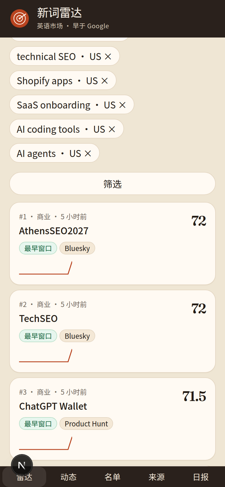

# KeywordRadar

[](LICENSE)

SEO 新词雷达。给做英语市场的 SEO 用的早期关键词雷达。它不去等 Google 趋势变热，而是先听社区、新品、仓库、通讯和竞品新页面，再用 Google 自动补全和每日趋势确认这个词是不是已经晚了。

界面是简体中文。数据源只覆盖海外英语市场（美国为主，种子可以选英国、加拿大、澳大利亚）。没有中文平台。




## 本地运行

需要 Node.js 22。

```bash
npm install
npm run dev
```

打开 [http://127.0.0.1:4317](http://127.0.0.1:4317)。

第一次启动会在一两分钟内自己跑一轮采集。页面上的「立即刷新」可以手动再跑。默认每 4 小时再跑一次（`CRON_HOURS`）。数据在 `data/radar.db`，SQLite，不需要单独装数据库。

生产模式：

```bash
npm run build
npm start
```

请用长期运行的 Node 进程，不要丢到会冻结后台任务的 serverless 上。调度和手动刷新都活在这个进程里。

## 什么样的词会进入推荐

推荐只收有独立年龄证据的新实体。已知长期产品及其版本（例如 Windows 10、TeamViewer，含大小写和空格变体）以及重新变热的旧词不会进入榜单或日报。本系统第一次采到、最近被提到、热度上升，都不能单独当证据。没有仓库创建时间、新品发布日或域名注册日这类证据时，记为待验证，留在库里，不进正式推荐，也不另开回热榜。原始摘录不会因此删除。进程启动后的第一次读榜会按同一规则重标已有候选。

## 词是怎么来的

发现源（越早越好）：

- Hacker News（Algolia）
- Product Hunt 新品 RSS，有 `PRODUCTHUNT_TOKEN` 时改走官方 GraphQL
- GitHub Trending，外加近 7 天高星新仓库
- Reddit 讨论监控：按行业盯 subreddit。有 `REDDIT_CLIENT_ID` / `REDDIT_CLIENT_SECRET` 用官方 API，否则用公开 RSS，并限速
- Bluesky 公开搜索
- Stack Exchange 新问题
- YouTube 频道 RSS；有 `YOUTUBE_API_KEY` 时再补搜索、标签
- Substack / 通讯 RSS、Medium 标签 RSS
- Google News RSS：这是新闻信号，不是趋势验证
- Sitemap 监控：读 robots.txt 和常见 sitemap，只把带 `lastmod`、近 72 小时的新 URL 当新页面。抓正文前先看 robots.txt
- X 大V：只读时间线。没有 `X_BEARER_TOKEN` 就关闭，并在界面上说明，不会把进程打崩，也不会关注任何账号
- TikTok、Quora、Amazon Movers、Etsy：尽力而为，被拦就记一笔失败
- Discord、Telegram、Threads：只有对应 token 才启用

Google 不是发现源。每轮结束时，对分数最高的一批词做两件事：

- 用少一个字符的前缀问自动补全，看完整词是否已经会被补出来
- 对照美国每日趋势 RSS

已经出现在 Google 的词阶段变成「已被 Google 收录」，机会分会被压低。还只出现在早期来源里的，标成「最早窗口」或「多源发酵」。

## 分数

机会分把这些东西合在一起，详情页能看到拆解：

- 发现分：新近程度、快照间的动量、跨来源数、是否还没进 Google
- 多个 X 账号说到同一个词、Reddit 和 X 同时出现、多个竞品站同一轮写到，都会加分
- 竞争：有 `SERPAPI_KEY` 或 DataForSEO 就拉前 10；否则用 DuckDuckGo 公开结果粗分权威站 / UGC / 小站，弱结果标成蓝海
- 占位：用 RDAP 查精确匹配 `.com` 是否还能注册、是不是刚被注走
- 商业价值：工具、对比、价格、联盟这一类说法
- 生命周期：快照太少就标「观察中」；冲高回落标短期热点，持续出现标可持续
- 大纲：有 `OPENAI_API_KEY`（或兼容接口）就让模型写；否则用模板

回测只统计「第一次发现时 Google 还没有，后来才出现」的词，算平均领先小时。样本够了之后，会小步调整「早发现」权重，一天最多一次。

## 信息源

X 账号和 Reddit 板块以自动发现为主。每个行业只留一小撮起步种子，方便第一次有地方出发；之后每周按热度、更新频率和跟行业种子的重合度重排。配了 `OPENAI_API_KEY` 时，会再用模型看一眼相关度；没有密钥就只用关键词重合。

- Reddit：用公开的板块搜索、帖子搜索、已跟踪板块侧栏里的 `r/`，以及雷达词出现过的板块。每个行业默认留下 15 个（`SUBREDDIT_DISCOVERY_LIMIT`）。
- X：配了 `X_BEARER_TOKEN` 或 `X_PROVIDER_BASE_URL` + `X_PROVIDER_API_KEY` 时，会搜行业种子的高互动帖，记下作者、被提及和被转发的账号。没有接口时，从 Reddit、Hacker News、Product Hunt、GitHub 主页的 `twitter_username` 和新闻正文里抽账号。每个行业默认留下 30 个（`X_DISCOVERY_LIMIT`）。
- 间隔由 `DISCOVERY_INTERVAL_DAYS` 控制，默认 7 天。信息源页可以点「立即发现」。
- 不活跃或跟行业对不上的会自动退出，并写下原因。手动添加、暂停、移除只是例外，手动加进去的不会被自动清掉。
- 账号和板块页能看到热度、讨论内容和这个来源贡献过的新词。总览按热度排序，可按行业筛。词详情里列出提到它的账号和板块。跨板块传播会抬高词的分数。

## 监控名单

行业：人工智能、SaaS / 创业、加密、电商 / DTC、营销 / SEO、健康、游戏、金融。

- X 大V、Reddit 社区、Reddit 活跃用户、竞品网站都可以改
- 采集时如果多个账号互相提及，或帖子里出现别的 `r/`，会变成「建议加入」。你点采用才会进下一轮
- 竞品新页面在「行业动态」里，词详情里也能看到 sitemap 证据

## 日报

默认每天 8:00（`Asia/Shanghai`）取还没被 Google 接住的前 10 个机会。

- 页面「日报与回测」始终看得到，采集结束也会留一份快照，但快照不会外发
- `SMTP_*` + `DIGEST_EMAIL_TO` 发邮件
- `TELEGRAM_BOT_TOKEN` + `TELEGRAM_CHAT_ID` 发 Telegram
- `DIGEST_WEBHOOK_URL` 收 JSON
- 「立即生成并发送」会按当前配置真的往外发

## 环境变量

完整模板在 `.env.example`。

| 变量 | 作用 |
| --- | --- |
| `X_BEARER_TOKEN` | X API v2，只读时间线 |
| `X_PROVIDER` / `X_PROVIDER_BASE_URL` / `X_PROVIDER_API_KEY` / `X_PROVIDER_AUTH` | 第三方 X 接口。不配官方 token 时走这里 |
| `X_DISCOVERY_LIMIT` / `SUBREDDIT_DISCOVERY_LIMIT` / `DISCOVERY_INTERVAL_DAYS` | 每个行业自动保留的账号、板块数量，以及重排间隔 |
| `REDDIT_CLIENT_ID` / `REDDIT_CLIENT_SECRET` | Reddit 官方 API |
| `YOUTUBE_API_KEY` | YouTube 搜索、标签、评论 |
| `GITHUB_TOKEN` | 提高 GitHub 搜索配额 |
| `STACKEXCHANGE_KEY` | 提高 Stack Exchange 配额 |
| `PRODUCTHUNT_TOKEN` | Product Hunt GraphQL |
| `DISCORD_BOT_TOKEN` / `DISCORD_CHANNEL_IDS` | 已加入频道的消息 |
| `TELEGRAM_BOT_TOKEN` / `TELEGRAM_CHANNEL_USERNAMES` | 公开频道；`TELEGRAM_CHAT_ID` 用于日报 |
| `THREADS_ACCESS_TOKEN` | Threads API |
| `SERPAPI_KEY` 或 `DATAFORSEO_LOGIN` + `DATAFORSEO_PASSWORD` | 竞争度 |
| `OPENAI_API_KEY` / `OPENAI_BASE_URL` / `OPENAI_MODEL` | 大纲 |
| `SMTP_HOST` `SMTP_PORT` `SMTP_USER` `SMTP_PASS` `SMTP_FROM` `DIGEST_EMAIL_TO` | 邮件日报 |
| `DIGEST_WEBHOOK_URL` | Webhook 日报 |
| `DIGEST_HOUR` `DIGEST_TZ` | 默认 8 点，Asia/Shanghai |
| `CRON_HOURS` | 采集间隔，默认 4 |

## 访问密码

公网部署前设置 `APP_PASSWORD`。登录后浏览器会留下 14 天的 HttpOnly cookie（`radar_session`）。

本地 `npm run dev` 不设这个变量时不锁，方便自己看。`NODE_ENV=production` 且没设密码时，页面和接口都会拒绝，避免一个空密码的雷达被扫到。

健康检查 `GET /api/health` 不需要密码，给平台探活用。

## 部署

这个进程必须一直活着：采集调度和早报都在 `instrumentation.ts` 里随 Node 进程启动，不是独立的 cron 容器。SQLite 在 `DATA_DIR`（容器里是 `/data`），这个目录要挂持久卷，否则重启后快照没了。

不要用会休眠的免费层，也不要用无状态 serverless（Vercel 一类）：机器睡了调度就停，磁盘一换库就丢。

当前环境没有 Fly、Render、Railway 或任何云主机的登录凭证，所以没有替你发布到公网。下面是你可以自己做的三种做法。

### 一台 VPS（Docker）

需要：一台 Linux 虚拟机，装好 Docker，以及你自己的 SSH。把仓库和填好的 `.env`（至少 `APP_PASSWORD`）放上去。

```bash
docker compose up -d --build
```

`docker-compose.yml` 会把命名卷 `radar-data` 挂到容器 `/data`。前面再加 Caddy 或 Nginx，把 443 转到 `127.0.0.1:4317`。看健康检查：`curl -fsS http://127.0.0.1:4317/api/health`。

不用 compose 时：

```bash
docker build -t seo-radar .
docker run -d --name seo-radar --restart unless-stopped \
  --env-file .env -e DATA_DIR=/data -e NODE_ENV=production \
  -p 4317:4317 -v seo-radar-data:/data seo-radar
```

### Fly.io

需要：Fly 账号，以及 `fly auth login` 之后本机的 Fly token。仓库里有 `fly.toml`：单机、不自动关机、卷挂在 `/data`、探活 `/api/health`。

```bash
fly apps create seo-keyword-radar
fly volumes create radar_data --region iad --size 1
fly secrets set APP_PASSWORD='你的密码' NODE_ENV=production
fly deploy
```

`app` 名字如果被占用，改 `fly.toml` 里的 `app`，卷名 `radar_data` 要和 `[[mounts]].source` 一致。部署完打开 `https://seo-keyword-radar.fly.dev`（以 Fly 实际给的域名为准）。

### Render

需要：Render 账号。新建 **Web Service**，环境选 Docker，方案用不会休眠的付费实例（免费实例会睡觉，调度会停）。

- Health Check Path：`/api/health`
- 环境变量：`APP_PASSWORD`、`NODE_ENV=production`、`DATA_DIR=/data`，外加你要用的可选密钥
- 添加 Disk，挂载路径 `/data`，至少 1 GB

保存后 Render 会给出 `https://<服务名>.onrender.com`。

### Railway

需要：Railway 账号。从仓库部署 Dockerfile。

- 变量：`APP_PASSWORD`、`NODE_ENV=production`、`DATA_DIR=/data`
- 给服务加 Volume，挂载路径 `/data`
- 生成公网域名。Railway 的 Web 服务默认不休眠，保持这一台一直开着。

三种都能用同一份镜像。密码、数据和调度都在这一台进程里，不要再水平扩成多副本，SQLite 不适合多写。

## 专名、需求词和趋势复核

这些能力都是可选增强。没有 `OPENAI_API_KEY` 时，专名判断不会跑，流水线照常结束；没有 `DATAFORSEO_LOGIN` / `DATAFORSEO_PASSWORD` 时，不拉搜索量、KGR、广告标记和 14 日 Google Trends 复核。

- 专名：从大小写、内部大写、数字和版本号里抽出候选，再用模型按每批 25 个词打 0 到 1 的「是不是新名字」分。低分且证据弱的片段会被压低或丢掉。详情页显示专名分。
- 通用需求词：把产品或仓库名改写成用户会搜的通用说法，并给出 优先 / 观察 / 跳过。搜索量够、趋势在升且结果页不挤时才是优先；平台把结果占满时，优先会降成观察。详情页和早报都会列出。
- GitHub 爆发：记录星标快照。新建不到 `GITHUB_BREAKOUT_MAX_AGE_DAYS`（默认 14）天且日均星标达到 `GITHUB_BREAKOUT_STARS_PER_DAY`（默认 200），或比上次快照多出 `GITHUB_BREAKOUT_STAR_DELTA`（默认 400）星，记第一次爆发，并展开仓库名、作者加仓库名、以及把连字符和驼峰拆开的写法。
- 14 日趋势复核：词被报出满 14 天后，若有 DataForSEO，比较报出后的峰值和报出前的基线。峰值要超过基线两倍并且至少再高 10 点才算命中；丢掉最近 2 天还不稳定的点。报出前基线已经很高，视为旧词义，不算命中。命中率和中位领先天数按来源显示在「日报与回测」，并参与早发现权重的微调。
- 竞争形态：每条 SERP 结果会标成工具、清单、文章、视频、论坛或官网，并区分首页和内页。平台域名占比决定 平台占据 / 可超越 / 有争夺。词第一次出现不到 180 天时，竞争档位放宽一级。有 DataForSEO 时额外给出 KGR 和是否出现广告。列表可以用 SERP 形态筛选。

## 限制

- 公开接口会限速，单轮不会把字母表砸向 Google。自动补全只验证已经发现的词。
- Reddit 的 JSON 在很多机房 IP 上是 403，所以默认走 RSS。RSS 没有分数，帖子热度要等官方 API 才准。
- TikTok、Quora、Amazon、Etsy 经常被拦，数据源页会写明失败原因。
- 生命周期和回测需要多轮快照。第一天大部分词会是「观察中」，这是故意的。

## 许可

个人使用和开源使用免费，遵循 [GNU AGPL-3.0](LICENSE)。如果你修改本软件，并通过网络向别人提供服务，AGPL 要求你向这些用户提供对应的源代码。

不想遵守 AGPL 的使用需要购买商业许可，包括闭源分发，以及不按 AGPL 公开修改的商业 SaaS。商业许可不由本仓库自动授予。说明见 [COMMERCIAL-LICENSE.md](COMMERCIAL-LICENSE.md)。仓库里没有单独的联系邮箱，请通过 [GitHub Issues](https://github.com/skillux-hub/KeywordRadar/issues) 联系我们。

**License.** Personal and open-source use is free under the [GNU Affero General Public License v3.0](LICENSE). If you modify this software and make it available over a network, the AGPL requires you to offer users the corresponding source. Closed-source distribution and commercial SaaS that does not comply with the AGPL require a paid commercial license. See [COMMERCIAL-LICENSE.md](COMMERCIAL-LICENSE.md). Contact us via [GitHub Issues](https://github.com/skillux-hub/KeywordRadar/issues).
